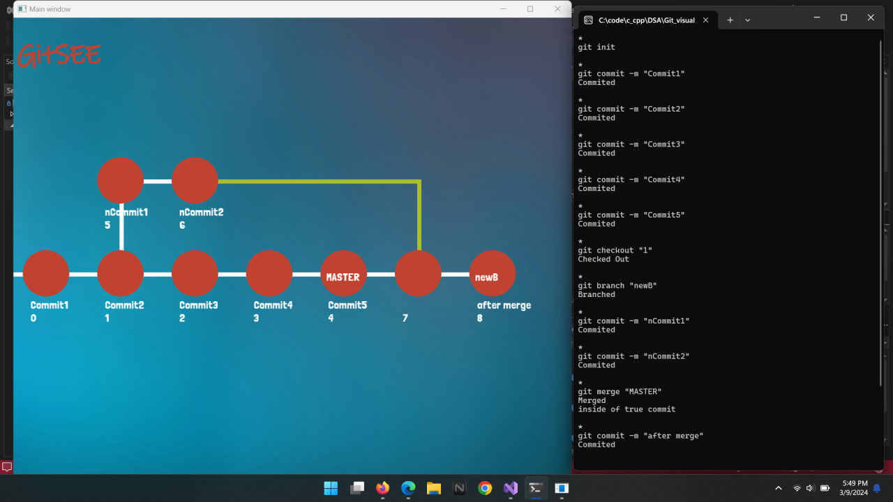

# Git Visualizer

A C++ desktop application that provides a graphical visualization of Git concepts and operations, built using SFML 2.5.1.

## Overview

Git Visualizer is a desktop application developed in C++ with SFML for graphical rendering and user interaction.

The project uses a modular architecture, separating GUI logic, input handling, parsing, and data structure algorithms into individual source and header files.

## Features

- Interactive graphical user interface
- Git-related visualization
- Modular C++ architecture
- SFML-based graphics and rendering

<!-- Update these features to match the actual implementation. -->

## Tech Stack

- **Language:** C++
- **Graphics Library:** SFML 2.5.1
- **IDE:** Visual Studio
- **Build System:** Visual Studio / MSBuild

## Project Structure

```text
.
├── Dependencies/
│   └── SFML-2.5.1/
├── headers/
│   ├── DSA.hpp
│   ├── guiLogic.hpp
│   ├── Input.hpp
│   └── Parser.hpp
├── src/
│   ├── DSA.cpp
│   ├── guiLogic.cpp
│   ├── Input.cpp
│   ├── main.cpp
│   └── Parser.cpp
├── arial.ttf
├── bg.jpg
├── logo.png
├── Git_visualisation.sln
└── Git_visualisation.vcxproj
```

## Prerequisites

- Windows 10/11
- Visual Studio 2019 or later
- C++ development tools (Desktop development with C++)
- SFML 2.5.1

## Installation and Setup

1. Clone the repository:

   ```bash
   git clone https://github.com/YOUR_USERNAME/YOUR_REPOSITORY.git
   ```

2. Open the solution file:

   `Git_visualisation.sln`

3. Ensure SFML 2.5.1 is available at the dependency path configured in the Visual Studio project.

4. Select the appropriate configuration:
   - Debug or Release
   - x64

5. Build the solution using Visual Studio.

6. Run the application.

## Screenshots


<h2 align="center">Application Preview</h2>

<p align="center">
  
</p>

<p align="center">
  
</p>


## Future Improvements

- Improve visualization and user interaction.
- Add additional Git concepts and operations.
- Improve cross-platform compatibility.
- Add documentation and testing.
